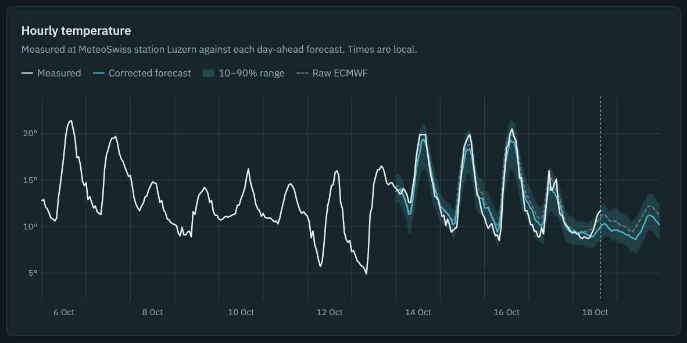
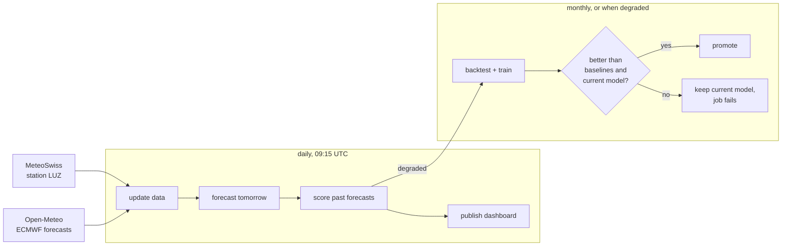

# lucerne-temp

Next-day temperature forecasts for Lucerne that are **19% more accurate than the
ECMWF global weather model**, with a calibrated uncertainty range. A model learns
ECMWF's local errors from MeteoSwiss measurements, and GitHub Actions runs everything:
new data, forecasts and scoring every day, retraining when needed.

**[Live dashboard](https://jonastheiler.github.io/lucerne_temp/)**: tomorrow's forecast
with its 10–90% range, the last 14 days of forecasts against measurements and raw
ECMWF, and how accurate the model has been so far. It updates after every daily run.



An end-to-end MLOps pipeline built from scratch, in about 800 lines of Python with four
dependencies and no framework hiding the steps:

- **Daily data and forecasts:** every day, GitHub Actions fetches new measurements
  and ECMWF forecasts and forecasts the next day.
- **Leakage-free backtest:** every month is predicted by a model trained only on earlier data.
- **Promotion gate:** a new model replaces the current one only if it beats both
  the baselines and the current model.
- **Live monitoring:** every forecast is scored against what was actually measured.
- **Automatic retraining:** monthly, or as soon as monitoring sees the model degrade.

**Stack:** Python · LightGBM · pandas · GitHub Actions · pytest · uv

I built it to learn MLOps on real data rather than a synthetic dataset.

## Results

On average the corrected forecast is off by 1.22 °C, against 1.50 °C for raw ECMWF.
Its 10–90% range contains the measured temperature 81% of the time, close to the 80%
it should.

Rolling-origin backtest, March 2025 to October 2026 (14,176 hours, every month predicted
by a model trained only on earlier data):

| | MAE (°C) | Pinball loss | 10–90% interval holds |
|---|---|---|---|
| Raw ECMWF forecast | 1.50 | 0.751 | – |
| ECMWF + typical error for that hour | 1.42 | 0.454 | 79% |
| **ECMWF + LightGBM correction** | **1.22** | **0.387** | **81%** |

The correction lowers the error by 19% and beats the raw forecast in 17 of 20 months.
The gains are largest from November to April, especially in March and April
(about 0.6 °C). Details: [reports/backtest.md](reports/backtest.md).
Live scores: [reports/monitoring.md](reports/monitoring.md), and as a chart on the
[dashboard](https://jonastheiler.github.io/lucerne_temp/).

## How it works

**Why correct ECMWF?** ECMWF runs one of the best global weather models. Its free
open data comes on a 0.25° grid, about 28 km north–south and 19 km east–west at
Lucerne ([ECMWF](https://www.ecmwf.int/node/28999), [Open-Meteo](https://open-meteo.com/en/docs/ecmwf-api)).
A grid cell that size averages lake, town and mountain slopes, so it can't see what
makes Lucerne's weather local: the lake, cold air collecting in the basin, or winter
fog. Those errors repeat in similar weather, so a model can learn them from past
forecasts and measurements.



The model doesn't predict the temperature, but **how wrong ECMWF will be**: observed minus
forecast. It does that for the 10%, 50% and 90% quantiles. Its inputs are the ECMWF forecast
(temperature, dew point, cloud, wind, pressure, rain), the hour and day of year, and
`recent_error`.

`recent_error` is how far ECMWF's day-ahead forecasts were off, on average, over the
24 hours before the forecast is made. Errors like that tend to persist: if fog or cold air in
the basin made ECMWF 2 °C too warm today, it will probably be too warm tomorrow as well.
It only uses measurements published by then, so the model never sees the future.

Everything runs in GitHub Actions and is stored in the repo: data as monthly Parquet
files, models as LightGBM text files, reports as Markdown. That means no server, no cloud
account and no secrets, and every change to data, model and score is versioned.

| Path | Content |
|---|---|
| `data/observations/` | Measured temperature at LUZ, hourly |
| `data/archive/` | ECMWF forecasts as issued about a day ahead |
| `data/forecasts/` | Our published forecasts, for scoring |
| `forecasts/latest.json` | Tomorrow's forecast, at a stable URL |
| `model/` | Current model and its card (training data, backtest scores) |

## Getting started

You need [uv](https://docs.astral.sh/uv/). No API keys. The data and the current model
are in the repo, so you can forecast right after cloning:

```bash
git clone https://github.com/jonastheiler/lucerne_temp.git
cd lucerne_temp
uv run python -m lucerne_temp.forecast   # update the last 3 days of data, forecast tomorrow
uv run python -m lucerne_temp.monitor    # score past forecasts
uv run python -m lucerne_temp.site       # build the dashboard in site/index.html
uv run python -m lucerne_temp.train      # backtest, train, promote if it passes the gate
uv run pytest
```

To rebuild all data from scratch (~2 min), run
`uv run python -m lucerne_temp.data 2024-03-01`. Without an end date it goes up to today.

These commands write to `data/`, `forecasts/`, `reports/` and, if a new model
passes the gate, `model/`. To undo that:
`git restore . && git clean -fd data forecasts reports model`.

## Project layout

In the order the code runs:

```
src/lucerne_temp/
├── config.py    # station, weather model, quantiles
├── data.py      # download, validate, store
├── forecast.py  # daily forecast
├── model.py     # features, LightGBM, calibration, metrics
├── monitor.py   # live scoring, retrain trigger
├── site.py      # build the dashboard page
├── site.html    # the dashboard template
└── train.py     # backtest, baselines, promotion gate
tests/           # one file per module, including the leakage test
.github/workflows/
├── daily.yml    # forecast, monitor, dashboard; starts a retrain if degraded
├── retrain.yml  # monthly, or when started by daily.yml
└── ci.yml       # lint and tests on main and pull requests
```

## Design decisions

- **Correct a weather model rather than replace it.** No single-station model will
  beat ECMWF, but its errors at Lucerne repeat and can be learned. National weather
  services do the same.
- **Train on forecasts as they were issued.** The archive holds the forecast made about a
  day before each hour, not the latest one, which would make the backtest look too good.
  A test checks that no feature uses an observation from after its issue time.
- **Intervals must be calibrated, not just predicted.** On their own, the quantile models
  were overconfident: their 10–90% interval held too few observations. Conformalized
  quantile regression widens the interval by a margin measured on held-out data.
- **A simple baseline sets the bar.** "ECMWF plus the typical error at that hour" is
  what a model with more inputs has to beat to justify its complexity.
- **A gate before promotion.** A new model replaces the current one only if it beats both
  baselines and isn't clearly worse than the current model. Otherwise the job fails visibly.
- **Monitoring that acts.** If the live forecast is no better than raw ECMWF over the last
  few weeks, or its intervals stop holding about 80% of observations, the daily job fails
  and starts a retrain. Coverage is judged only after three weeks, because a single calm
  or stormy week pushes it out of range on its own.
- **Files instead of an API.** Forecasts change once a day, so `forecasts/latest.json`
  serves them. A web server would add cost and moving parts without making them fresher.
- **Fail loudly, retry politely.** Data is validated before anything is written. Stale
  observations stop the forecast. Temporary API errors are retried with backoff.

## Known limitations

- **Training and serving use close, but not identical, lead times.** Training uses the
  archived forecasts from the ECMWF run a day earlier; the daily job uses the latest
  run available in the morning. Live monitoring measures the effect.
- **The archive only goes back to March 2024**, so the backtest has just one full
  winter in it.
- **One interval width for all weather.** The calibration margin is a single number, the
  same in summer and winter, fog and sunshine. So the interval is probably too wide in calm
  weather and too narrow in difficult weather. A margin per season, or one that scales with
  the predicted spread, would fix that.
- **GitHub Actions doesn't guarantee timing.** Scheduled runs often start hours late.
  That's fine for a learning project; a real service would need its own scheduler.
- **One station.** The same code could loop over several stations, with altitude and
  location as features.
