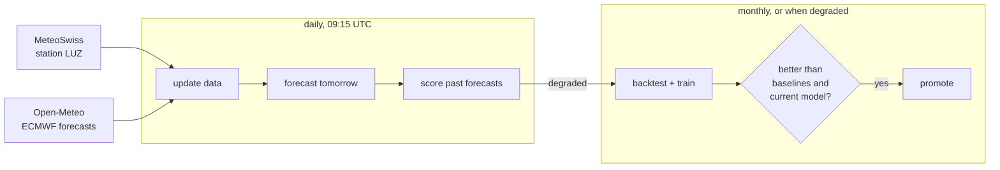

# lucerne-temp

Better next-day temperature forecasts for Lucerne. A global weather model (ECMWF) is
corrected with MeteoSwiss measurements, and every forecast comes with an uncertainty
interval. The project is a small but complete MLOps setup: daily data and forecasts,
a backtest, a promotion gate, live monitoring and automatic retraining.

It's meant to be read. The code is about 700 lines with four dependencies.

## Results

Rolling-origin backtest, March 2025 to October 2026 (14,176 hours, every month predicted
by a model trained only on earlier data):

| | MAE (°C) | Pinball loss | 10–90% interval holds |
|---|---|---|---|
| Raw ECMWF forecast | 1.50 | 0.751 | – |
| ECMWF + typical error for that hour | 1.42 | 0.454 | 79% |
| **ECMWF + LightGBM correction** | **1.22** | **0.387** | **81%** |

The correction lowers the error by 19% and beats the raw forecast in 17 of 20 months.
The gains are largest from November to April, the months in which raw ECMWF is
worst. Details: [reports/backtest.md](reports/backtest.md).
Live scores: [reports/monitoring.md](reports/monitoring.md), and as a chart on the
[dashboard](https://jonastheiler.github.io/lucerne_temp/).

## How it works



The model doesn't predict the temperature, but **how wrong ECMWF will be**: observed minus
forecast. It does that for the 10%, 50% and 90% quantiles. Its inputs are the ECMWF forecast
(temperature, dew point, cloud, wind, pressure, rain), the hour and day of year, and how
wrong ECMWF was over the past 24 hours.

Everything runs in GitHub Actions and is stored in the repo: data as monthly Parquet
files, models as LightGBM text files, reports as Markdown. That means no server, no cloud
account and no secrets, and every change to data, model and score is versioned.

| Path | Content |
|---|---|
| `data/observations/` | Measured temperature at LUZ, hourly |
| `data/archive/` | ECMWF forecasts as issued about a day ahead |
| `data/forecasts/` | Our published forecasts, for scoring |
| `forecasts/latest.json` | Tomorrow's forecast, at a stable URL |
| `model/` | Current model and its card (training data, backtest scores) |

## Getting started

You need [uv](https://docs.astral.sh/uv/). No API keys.

```bash
uv run python -m lucerne_temp.data 2024-03-01 2026-10-13   # backfill (~2 min)
uv run python -m lucerne_temp.train                         # backtest, train, promote
uv run python -m lucerne_temp.forecast                      # forecast tomorrow
uv run python -m lucerne_temp.monitor                       # score past forecasts
uv run pytest
```

## Project layout

```
src/lucerne_temp/
├── config.py    # station, weather model, quantiles
├── data.py      # download, validate, store
├── model.py     # features, LightGBM, calibration, metrics
├── train.py     # backtest, baselines, promotion gate
├── forecast.py  # daily forecast
└── monitor.py   # live scoring, retrain trigger
```

## Design decisions

- **Correct a weather model rather than replace it.** No single-station model will
  beat ECMWF. But ECMWF's 25 km grid can't see the lake or the local terrain, and those
  errors repeat. Correcting them is what national weather services do, too.
- **Train on forecasts as they were issued.** The archive holds the forecast made about a
  day before each hour, not the latest one, which would make the backtest look too good.
  A test checks that no feature uses an observation from after its issue time.
- **Intervals must be calibrated, not just predicted.** On their own, the quantile models
  were overconfident: their 10–90% interval held only 63% of the observations. Conformalized
  quantile regression widens the interval by a margin measured on held-out data, which
  brings it to 81%.
- **A simple baseline sets the bar.** "ECMWF plus the typical error at that hour" is
  what a model with more inputs has to beat to justify its complexity.
- **A gate before promotion.** A new model replaces the current one only if it beats both
  baselines and isn't worse than the current model. Otherwise the job fails visibly.
- **Monitoring that acts.** If the live forecast is no better than raw ECMWF over 4 weeks,
  or its intervals stop holding about 80%, the daily job fails and starts a retrain.
- **Files instead of an API.** Forecasts change once a day, so `forecasts/latest.json`
  serves them. A web server would add cost and moving parts without making them fresher.
- **Fail loudly, retry politely.** Data is validated before anything is written. Stale
  observations stop the forecast. Temporary API errors are retried with backoff.

## Known limitations

- **Training and serving use slightly different lead times.** Training uses forecasts
  issued about 24 hours ahead; the daily job forecasts 13 to 37 hours past its issue
  time. Live monitoring measures the effect.
- **The archive only goes back to March 2024**, so the backtest has just one full
  winter in it.
- **One station.** The same code could loop over several stations, with altitude and
  location as features.
